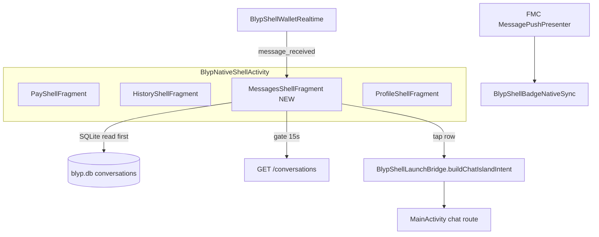

# Blyp — plan migration Messages (natif Android)

Document de travail pour la **phase 2** décrite dans [`BLYP-CLIENT-NATIF.md`](./BLYP-CLIENT-NATIF.md).  
Contrats perf : [`blyp-perf-light.mdc`](../.cursor/rules/blyp-perf-light.mdc) · gates : [`blyp-feature-gates.mdc`](../.cursor/rules/blyp-feature-gates.mdc).

**État actuel (v1)** : onglet Messages → `MainActivity` (îlot RN) via `BlypShellLaunchBridge.buildMessagesIslandIntent`. Badge / push / deep link déjà gérés côté natif (`BlypShellBadgeNativeSync`, `MessagePushPresenter`, `BlypShellDeepLink`). Pay / Historique / Profil = fragments natifs (`BlypNativeShellActivity`).

**Objectif produit** : ouverture Messages **sans Metro**, liste **instantanée** (SQLite partagé avec RN), fil **inchangé en RN** jusqu’à la phase suivante.

---

## 1. Découpage en phases

| Phase | Livrable | Îlot RN restant |
|-------|-----------|-----------------|
| **0 — Socle données** | Lecture SQLite `conversations` + lignes UI préformatées ; sync liste API avec gate 15 s | Liste + fil RN |
| **1 — Liste native (MVP)** | `MessagesShellFragment` dans la coque ; clic → `buildChatIslandIntent` | Fil, nouveau chat, forward, Actus |
| **2 — Liste complète** | Statuts, receipts preview, typing sur liste, pull refresh, recherche contact | Fil + pièces jointes |
| **3 — Fil natif** | Scroll inversé, envoi texte, swipe reply, réactions, voix, images, argent | Forward massif, edge cases |
| **4 — Retrait îlot** | Plus de `MainActivity` pour Messages ; WS chat 100 % Kotlin | — |

Ce document détaille **0 → 2** (prochaine vague de dev). **3** = chantier séparé (`docs/VOICE-MESSAGES.md` + spec `ChatThreadScreen.tsx`).

---

## 2. Architecture cible (phase 1)



**Règles**

- **Cache-first** : au focus, binder la liste depuis SQLite (`conversations` tri `updatedAt DESC`) ; **aucun** spinner si ≥1 ligne.
- **Defer** : `GET /conversations` après le 1er frame (handler `post` / coroutine `Dispatchers.Main` + IO).
- **Gate** : même intervalle que RN — **15 s** minimum entre pulls réseau (`conversationsListGate.ts` → port Kotlin `CONV_LIST_MIN_PULL_MS = 15_000`).
- **Skip setState** : si JSON trié identique au snapshot précédent, ne pas rebinder RecyclerView.
- **Clic conversation** : uniquement handoff RN fil (déjà en prod) ; **prefetch** fil optionnel phase 2 (RN garde `prefetchChatThreadOnPressIn` côté îlot jusqu’à fil natif).

---

## 3. Données & contrats (alignés RN)

### SQLite (existant — `lib/db/sqlite.ts`)

```sql
conversations (phone, id, json, updatedAt)
chat_messages (phone, conversationId, json)  -- blob par fil, utilisé pour preview / fil RN
chat_receipts (phone, conversationId, peerLastReadAt, peerLastDeliveredAt)
kv_cache (phone, key, json)  -- unread_total, etc.
```

**Nouveau module Kotlin recommandé** : `native-android/shell/messages/`

| Fichier | Rôle |
|---------|------|
| `BlypShellConversationsStore.kt` | Read/write conversations ; tri activité ; égalité snapshot |
| `BlypShellConversationListRow.kt` | Modèle ligne UI (nom, preview, heure, badge unread, ticks preview) |
| `BlypShellConversationPreview.kt` | Port logique `conversationListPreview.ts` + `previewTicks.ts` (texte, doc, voix, fruit money, supprimé) |
| `BlypShellConversationsSync.kt` | HTTP `GET /conversations` ; merge ; écrit SQLite ; notif UI |
| `BlypShellConversationsListGate.kt` | Throttle pull |

**Réutilisation** : `BlypShellKvCache.openDb` pour chemin DB ; token via `BlypShellSession` / miroir auth existant (même pattern que historique).

### API

- Liste : `GET /conversations` — spec `lib/api/client.ts` `listConversations`.
- Types : champs `Conversation` dans `lib/api/types.ts` (JSON stocké tel quel dans SQLite).

### Realtime / badge

- Frames WS `message_received`, `conversation_typing`, etc. : aujourd’hui partiellement forward RN via `BlypShellBridge`. **Phase 1** : continuer à mettre à jour badge natif ; **phase 1b** : patch store conversations sur `message_received` sans ouvrir RN.
- Push : inchangé ; deep link `blyp://chat/{id}` → soit liste native + auto-open fil RN, soit direct `buildChatIslandIntent` (comportement actuel conservé).

---

## 4. UI phase 1 (parité minimale)

Référence UX : `components/messages/ConversationsScreen.tsx`.

| Fonction RN | Phase 1 natif | Phase 2 |
|-------------|---------------|---------|
| Liste conversations + avatars | Oui | — |
| Preview dernier message + ticks | Texte + heure | Doc/voix/money/reaction |
| Badge non-lus par fil | Oui (depuis JSON conv) | — |
| Pull-to-refresh | Oui (pattern `HistoryShellFragment`) | — |
| FAB / nouveau chat | Handoff `buildMessagesIslandIntent` + route `new-chat` | Natif `NewChat` |
| Actus / StatusRing | Non | Oui |
| Retour onglet autre que Messages | Natif (fragment, pas Activity) | — |
| i18n FR/EN | `blyp_shell_strings` | — |
| Thème clair/sombre | Couleurs shell existantes | — |

**Navigation shell** : remplacer `startActivity(buildMessagesIslandIntent)` par `selectTab(MESSAGES)` + `MessagesShellFragment` (étendre `Tab.MESSAGES` dans `BlypNativeShellActivity` — aujourd’hui `throw` dans `newFragment`).

**Perf** : mark `messages_open` dans `BlypShellPerfMarks` (miroir `history_open`).

---

## 5. Fil RN (inchangé phase 1)

- Entrée : `BlypShellLaunchBridge.buildChatIslandIntent` / payload `route=chat`.
- RN garde : `messagesCache`, `threadPullGate`, envoi, PJ, voix.
- **Risk** : double écriture SQLite si liste native et RN pull en parallèle → **une seule source merge** : après sync natif, RN au focus fil relit SQLite (déjà le cas) ; éviter deux pulls simultanés en partageant timestamp gate (option : clé `kv_cache` `conversations_last_pull_at`).

---

## 6. Ordre d’implémentation (sprints)

### Sprint A — Socle (phase 0)

1. `BlypShellConversationsStore` : lecture paginée, parse JSONObject → champs affichables.
2. Tests instrumentés ou JVM : tri, égalité snapshot, fichier DB fixture.
3. `BlypShellConversationsSync` + gate 15 s + auth header (copier pattern client historique/wallet si existant).

### Sprint B — Liste MVP (phase 1)

1. Layout `blyp_shell_messages_list.xml` + `MessagesShellFragment` + `RecyclerView` (ViewHolder léger, pas Compose v1 pour homogénéité shell).
2. Brancher tab Messages dans `BlypNativeShellActivity`.
3. Clic ligne → `buildChatIslandIntent` ; bouton nouveau → intent route `new-chat` (extra à documenter dans `LaunchBridge`).
4. `hideMessagesLoading` : supprimer overlay au 1er bind si liste non vide ; sinon garder jusqu’au paint RN sur handoff fil uniquement.
5. Smoke Redmi 9C : cold start → Messages onglet **sans** lancer Metro ; liste depuis cache.

### Sprint C — Parité liste (phase 2)

1. Preview riche + ticks (`BlypShellConversationPreview`).
2. WS : incrément liste / reorder sur `message_received`.
3. Actus : soit bandeau simplifié, soit lien vers îlot RN « actus only » (décision produit).
4. Nouveau chat natif (contacts + `POST /conversations`).

### Sprint D+ — Fil natif (phase 3)

Plan dédié : découper `ChatThreadScreenBody.tsx` en moteurs (liste messages, composer, gestures). Prioriser **texte + scroll + envoi optimiste** avant voix/argent.

---

## 7. Critères d’acceptation (fin phase 1)

- Onglet Messages dans la coque : **&lt; 1 frame** liste si SQLite a des conversations (mesure `messages_open`).
- Pas de régression badge / notif / deep link chat.
- Pull manuel rafraîchit ; pull auto respecte 15 s.
- Clic fil : même expérience qu’aujourd’hui (îlot RN).
- Build release **sans** ouvrir l’îlot RN pour consulter la liste.

---

## 8. Hors scope / risques

| Sujet | Note |
|-------|------|
| iOS | Android-first ; même contrats SQLite/API |
| Réécriture complète fil | Phase 3+ ; ne pas bloquer phase 1 |
| Duplication logique preview | Acceptable court terme ; extraire spec JSON tests partagés si drift |
| Demo convs `demo-conv-*` | Tri en bas comme RN (`sortConversationsByActivity`) |
| Commerce / Soa | Pas d’impact Messages tab |

---

## 9. Prochaine action code (après validation plan)

1. Créer `native-android/shell/messages/BlypShellConversationsStore.kt`.
2. `MessagesShellFragment` + modifier `BlypNativeShellActivity` (tab MESSAGES réel).
3. Feature flag : `BlypShellFeatureFlags.nativeMessagesList` (désactivé = comportement actuel handoff full RN) pour déploiement progressif.

---

*Dernière mise à jour : plan initial phase 0–2 — à valider par Harold avant Sprint A.*